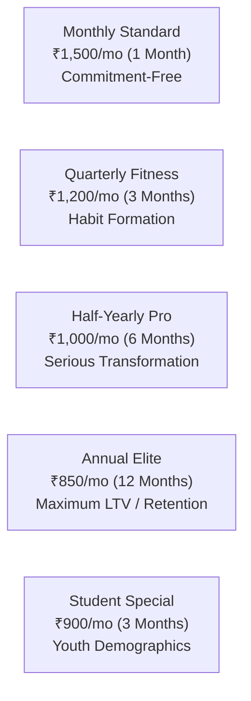
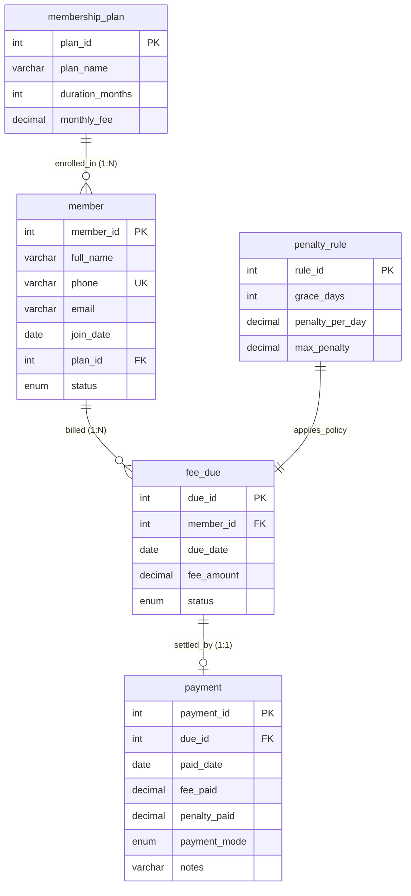
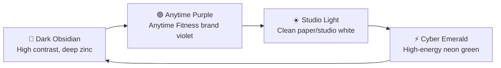

# Anytime Fitness Sohna — Member Management & Revenue Operations Platform

A production-grade, high-performance gym management platform designed and engineered for **Anytime Fitness (Sohna Branch)**. The system streamlines member lifecycle management, recurring subscription billing, transparent late-fee penalty automation, direct WhatsApp collection workflows, and multi-channel financial reconciliation.

---

## 📌 Executive Summary

Modern fitness centers operate on recurring subscription cash flows. However, independent and franchise fitness clubs routinely lose **10% to 18% of their monthly recurring revenue (MRR)** to delayed payments, uncollected late fees, untracked membership expiries, and awkward manual collection calls.

**Anytime Fitness Sohna Platform** eliminates revenue leakage by combining an **ACID-compliant relational database engine** with an intuitive, zero-dependency management interface. It automates recurring billing cycles, provides fair and transparent late penalty math, and arms gym staff with 1-click WhatsApp reminders and printable tax invoices.

---

## 🏢 Business-Wise Deep Dive

### 1. The Core Business Problem in Gym Operations

| Operational Bottleneck | Impact on Gym Operations | How Anytime Fitness Sohna Solves It |
| :--- | :--- | :--- |
| **Manual Due Tracking** | Staff forgets who is due on what date; members train weeks past their expired validity. | Automated due scheduler generates the next billing cycle immediately upon member enrollment or renewal. |
| **Defaulter Friction & Awkward Calls** | Calling members for late fees causes friction and damages customer retention. | One-click formatted WhatsApp reminders with itemized due dates, base fees, and billable days. |
| **Arbitrary / "Fishy" Late Fees** | Unclear penalty rules trigger customer disputes, distrust, and negative Google reviews. | Strict mathematical model: 5 free grace days, transparent daily rate (₹10/day), and an enforced statutory cap (₹500). |
| **Disjointed Payment Channels** | Cash collected at the desk, UPI payments on owner's phone, and POS cards are never reconciled. | Single-ledger transaction system tracking settlement mode (UPI, Cash, Card) with payment receipt numbers. |
| **Lack of Formal Invoicing** | Corporate members and GST filers demand invoices; paper slips get lost. | Professional, itemized printable tax invoices with built-in print styling (`@media print`). |

---

### 2. Strategic Membership Tiering

The club provides five structured membership plans catering to diverse customer demographics:



- **Monthly Standard**: High-margin entry tier for trial members and short-stay residents.
- **Quarterly Fitness**: 20% discount incentivizing commitment beyond the 21-day fitness habit threshold.
- **Half-Yearly Pro**: 33% discount targeting transformation candidates with semi-annual billing.
- **Annual Elite**: Maximizes Customer Lifetime Value (LTV), secures 12-month upfront commitment, and lowers gym attrition.
- **Student Special**: Discounted quarterly package for colleges and universities around Sohna Road.

---

### 3. The Penalty Economics & Behavioral Model

A harsh penalty policy alienates gym members, while zero penalty encourages indefinite payment delays. Anytime Fitness Sohna implements an **Incentive-Compatible Behavioral Penalty Framework**:

1. **Free Grace Period (5 Days)**:
   - Recognizes that salary processing, bank holidays, and busy schedules cause minor delays.
   - For the first 5 days following the due date, members pay **₹0 penalty**.
   - The UI displays an amber badge: `Grace (Xd left)`.
2. **Predictable Daily Incentive (₹10.00 / day)**:
   - Beginning on Day 6, the penalty accumulates at a constant, fair daily rate (₹10/day).
   - Only **billable days** (elapsed days minus grace days) are charged.
   - Example: 29 days past due date = 24 billable days × ₹10 = ₹240 penalty.
3. **Statutory Cease-Fire Cap (₹500.00 Max Ceiling)**:
   - Prevents penalties from escalating beyond reasonable proportions (e.g. on a ₹1,500 monthly fee, a penalty cannot exceed ₹500 regardless of elapsed time).
   - Protects the club from consumer protection disputes and gives long-term defaulters a viable path to settle and rejoin.
4. **Managerial Waiver Flexibility**:
   - The desk manager can adjust or waive late fees during payment settlement for genuine medical leaves, out-of-station travels, or promotional waivers, accompanied by reference notes.

---

### 4. Key Performance Indicators (KPIs) Tracked

The dashboard calculates real-time metrics essential for fitness facility viability:
- **Member Retention Rate**: `(Active Members / Total Members) × 100` (Benchmark: > 80%).
- **Fee Collection Efficiency**: `(Settled Revenue / Total Billed Receivables) × 100`.
- **Delinquency Risk Factor**: Ratio of overdue dues beyond the grace period to total pending memberships.
- **Payment Gateway Split**: Percentage distribution across UPI (digital direct), POS Card, and Desk Cash.

---

## 💻 Tech-Wise Engineering Design

### 1. Technology Stack Rationale

```
Frontend: Vanilla ECMAScript (ES Modules) — Zero runtime framework dependencies
CSS Engine: Dynamic CSS3 Custom Properties (Multi-Theme Architecture)
Build Tool: Vite 8 (Hot Module Replacement & Tree-Shaken Production Bundles)
Database: MySQL 8.0+ / MariaDB (Relational Schema in 3NF)
Persistence: Dual-Mode (Relational MySQL Server Scripts + Browser LocalStorage Sync)
```

- **Why Vanilla JavaScript?**
  Zero dependency bloat, near-instant initial paint (< 100ms), zero security audit vulnerabilities (`npm audit` clean), and guaranteed long-term maintainability without breaking framework version churn.
- **Why Dynamic CSS Variables?**
  Allows instant, flicker-free visual theme transitions (`theme-dark`, `theme-purple`, `theme-light`, `theme-emerald`) by swapping high-level CSS custom properties on `document.documentElement` without DOM re-renders.

---

### 2. Database Relational Architecture (`gym_db`)

The database schema strictly adheres to **Third Normal Form (3NF)**:



#### Relational Integrity & Constraint Guarantees
- **Foreign Key Actions**:
  - `member.plan_id` references `membership_plan.plan_id` with `ON DELETE RESTRICT` (prevents deleting active plans while members are enrolled).
  - `fee_due.member_id` references `member.member_id` with `ON DELETE CASCADE` on historical archives, guarded by application checks preventing deletion if pending balances exist.
  - `payment.due_id` references `fee_due.due_id` with `ON DELETE RESTRICT` (prevents deleting settled dues).
- **Domain CHECK Constraints**:
  - `membership_plan.duration_months > 0`
  - `membership_plan.monthly_fee > 0`
  - `penalty_rule.grace_days >= 0`
  - `penalty_rule.penalty_per_day >= 0`
  - `fee_due.fee_amount > 0`
  - `payment.fee_paid >= 0` and `payment.penalty_paid >= 0`
- **Performance Indexes**:
  - `idx_member_phone`: Unique index accelerating member search during check-in.
  - `idx_fee_due_status`: Index filtering pending vs settled dues.
  - `idx_fee_due_date`: Accelerates overdue date range queries and penalty evaluations.
  - `idx_payment_date`: Speeds up daily and monthly revenue reconciliation.

---

### 3. Mathematical Model of the Late Fee Engine

The calculation engine in [`src/js/penalty.js`](src/js/penalty.js) evaluates dues with calendar precision:

Let $D_{\text{due}}$ be the due date, $D_{\text{today}}$ be the current evaluation date at local midnight ($00:00:00$), $G$ be the grace period in days ($5$), $R$ be the daily penalty rate ($\text{₹}10.00$), and $M$ be the maximum penalty cap ($\text{₹}500.00$).

$$\Delta_{\text{days}} = \text{round}\left(\frac{D_{\text{today}} - D_{\text{due}}}{86,400,000\text{ ms}}\right)$$

#### State Machine & Evaluation Rules:

1. **Future Due Date** ($\Delta_{\text{days}} < 0$):
   $$\text{Penalty} = 0, \quad \text{Days Until Due} = |\Delta_{\text{days}}|$$
2. **Due Today** ($\Delta_{\text{days}} = 0$):
   $$\text{Penalty} = 0, \quad \text{Status} = \text{Due Today}$$
3. **Within Grace Period** ($1 \le \Delta_{\text{days}} \le G$):
   $$\text{Penalty} = 0, \quad \text{Grace Days Remaining} = G - \Delta_{\text{days}}$$
4. **Overdue Past Grace Period** ($\Delta_{\text{days}} > G$):
   $$\text{Chargeable Days} = \Delta_{\text{days}} - G$$
   $$\text{Raw Penalty} = \text{Chargeable Days} \times R$$
   $$\text{Final Penalty} = \min(M, \text{Raw Penalty})$$
   $$\text{Total Payable} = \text{Base Fee} + \text{Final Penalty}$$

#### Mathematical Example:
- Member: *Kavita Patil* | Due Date: *10 Oct 2026* | Current Date: *8 Nov 2026*
- Total Days Elapsed: $29\text{ days}$
- Free Grace Period: $5\text{ days}$
- Billable Days: $29 - 5 = 24\text{ days}$
- Rate: $24 \times \text{₹}10.00 = \text{₹}240.00$
- Cap Check: $\min(\text{₹}500.00, \text{₹}240.00) = \text{₹}240.00$
- Total Due: $\text{₹}1,500.00 + \text{₹}240.00 = \text{₹}1,740.00$
- The UI displays: `Overdue (29d)` with subtitle `24 billable days × ₹10`.

---

### 4. Dynamic Theming Engine (Single-Click Switcher)

Rather than cluttering the header with dropdown menus, the system provides an accessible **Theme Cycling Icon Button** in the header. Clicking the button immediately cycles through 4 custom themes:



- Selected theme is cached in `localStorage.getItem('af_theme')` and applied prior to initial DOM render to eliminate flash-of-unstyled-content (FOUC).

---

### 5. Automated Data Sanitation & Phone Normalization

To enforce unique phone constraints across variations in customer input:
```javascript
export function normalizePhone(phone) {
  if (!phone) return '';
  return phone.replace(/[^0-9]/g, '');
}
```
Input variations like `+91 98201 12345`, `9820112345`, and `(098) 201-12345` all resolve to `9820112345`, preventing accidental duplicate member entries in the database.

---

## 🚀 Quick Setup & Execution

### 1. Prerequisites
- **Node.js** v18+ (with npm)
- Any modern web browser (Chrome, Edge, Firefox, Safari)

### 2. Local Development
```bash
# Clone or navigate to the repository
cd "H:\CLG\SEM 3\DBMS\capstone"

# Install dev dependencies (Vite)
npm install

# Launch local development server with Hot Module Replacement
npm run dev
```
Open **`http://localhost:5173`** in your browser.

### 3. Production Build
```bash
# Compile and optimize assets into ./dist
npm run build

# Preview production build locally
npm run preview
```

### 4. Free Online Cloud Deployment (In 60 Seconds)
The application has no server-side runtime lock-in. You can deploy it live for free:
- **Netlify Drop**: Drag and drop the `dist/` folder into [app.netlify.com/drop](https://app.netlify.com/drop).
- **Vercel CLI**: Run `npx vercel deploy --prod` from the project directory.

---

## 🗄️ MySQL Database Scripts (`./database/`)

For running in MySQL Workbench or phpMyAdmin:
- Master Script: [`database/gym_db_complete.sql`](database/gym_db_complete.sql)
- DDL Schema: [`database/01_schema.sql`](database/01_schema.sql)
- Seed Records: [`database/02_seed_data.sql`](database/02_seed_data.sql)
- Analytical Views: [`database/03_views.sql`](database/03_views.sql)
- Stored Procedures: [`database/04_procedures_triggers.sql`](database/04_procedures_triggers.sql)
- Queries Cheat Sheet: [`database/05_queries.sql`](database/05_queries.sql)

---

## 📄 License & Ownership

Developed for **Anytime Fitness (Sohna Branch)**. All rights reserved.
