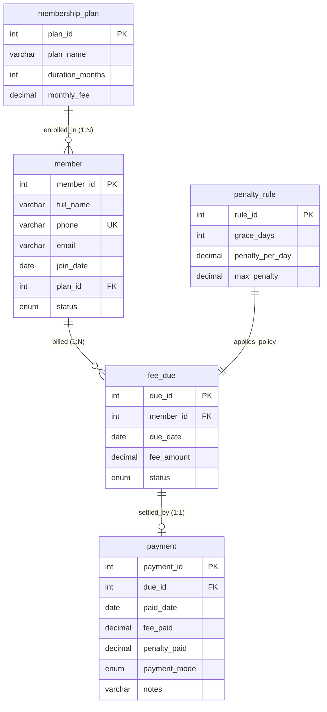

# Apex Gym Database (`gym_db`) — Teacher & Evaluation Guide

This folder contains the complete, production-grade relational database scripts for the **Semester 3 DBMS Capstone Project**.

---

## 📁 Database Directory Structure

| File | Description |
| :--- | :--- |
| [`gym_db_complete.sql`](./gym_db_complete.sql) | **Master All-In-One Script**: Run this single file in MySQL Workbench or phpMyAdmin to install the entire database (schema, indexes, seed records, views, stored procedure, triggers). |
| [`01_schema.sql`](./01_schema.sql) | **DDL Schema**: `CREATE TABLE` statements with primary keys, foreign keys, `CHECK` constraints, and performance indexes. |
| [`02_seed_data.sql`](./02_seed_data.sql) | **Seed Records**: 15 members, 5 plans, 15 fee dues across all lifecycle states, and 7 settled payment transactions. |
| [`03_views.sql`](./03_views.sql) | **Relational Views**: 4 analytical views for financial reconciliation, overdue tracking, and ledger audits. |
| [`04_procedures_triggers.sql`](./04_procedures_triggers.sql) | **ACID Transactions & Triggers**: `sp_record_payment` procedure, renewal generator, and payment validation triggers. |
| [`05_queries.sql`](./05_queries.sql) | **Academic DBMS Queries**: 8 queries demonstrating `INNER JOIN`, `LEFT JOIN`, `GROUP BY`, `HAVING`, subqueries, and date arithmetic. |

---

## ⚡ Quick Start: How to Run in MySQL

### Option A: Using MySQL Command Line (CLI)
```bash
mysql -u root -p < database/gym_db_complete.sql
```

### Option B: Using MySQL Workbench
1. Open **MySQL Workbench** and connect to your local MySQL instance.
2. Go to **File → Open SQL Script...** and select `database/gym_db_complete.sql`.
3. Click the ⚡ **Execute (all queries)** icon (or press `Ctrl + Shift + Enter`).
4. In the left sidebar (*SCHEMAS*), right-click and select **Refresh All** — `gym_db` will appear with all tables, views, and procedures.

### Option C: Using phpMyAdmin (XAMPP / WAMP)
1. Open your browser at `http://localhost/phpmyadmin`.
2. Click the **Import** tab in the top navigation bar.
3. Click **Choose File**, select `database/gym_db_complete.sql`, and click **Go**.

---

## 📊 Relational Database Architecture



---

## 🎓 Teacher Evaluation & Viva Walkthrough

When presenting your capstone to your DBMS teacher, follow this proven 5-step sequence:

### Step 1: Explain Schema Constraints & Normalization
- Open `01_schema.sql`.
- Point out **3NF (Third Normal Form)** compliance: Plans are abstracted from Members, Dues are abstracted from Payments.
- Show **Foreign Keys** with `ON UPDATE CASCADE ON DELETE RESTRICT` to protect business data.
- Show domain integrity **CHECK constraints**:
  - `monthly_fee > 0`
  - `duration_months > 0`
  - `grace_days >= 0`
  - `fee_paid >= 0`

### Step 2: Show Indexes for Query Performance
- Point out the indexes created on high-cardinality search fields:
  - `idx_member_phone` on `member(phone)`
  - `idx_fee_due_member` on `fee_due(member_id)`
  - `idx_fee_due_status` on `fee_due(status)`
  - `idx_payment_due` on `payment(due_id)`

### Step 3: Demonstrate Stored Procedure & ACID Transactions
- Open `04_procedures_triggers.sql`.
- Explain `sp_record_payment`:
  - When payment is received, it executes `START TRANSACTION`.
  - Atomically inserts the `payment` receipt and updates `fee_due.status = 'Paid'`.
  - If any error occurs, it triggers `ROLLBACK` to prevent partial updates.

### Step 4: Run Complex DBMS Queries
- Open `05_queries.sql` in MySQL Workbench and execute:
  - **Query 1**: 3-Table `INNER JOIN` displaying the Member Ledger.
  - **Query 2**: `GROUP BY` and `SUM` revenue aggregated per plan.
  - **Query 3**: `HAVING` clause filtering high-grossing plans.
  - **Query 4**: `LEFT JOIN` detecting members with zero completed payments.
  - **Query 7**: Real-time penalty arithmetic using `DATEDIFF` against `penalty_rule`.

### Step 5: Show the Live Web Interface
- Run `npm run dev` and navigate to `http://localhost:5173`.
- Open the **⚡ DBMS Studio** tab in the top header.
- Execute the interactive queries in the browser, show the live DML execution stream, and export the database dump!

